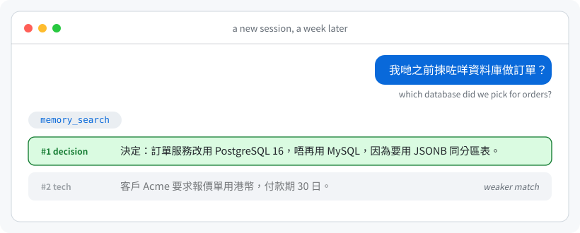
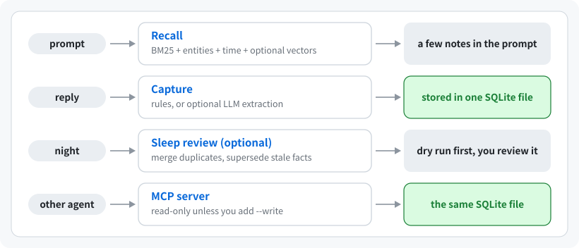

<div align="center">

# Hermind

**Long-term memory for AI agents, in one SQLite file on your machine.**

Decisions, preferences and facts survive between sessions and come back even when you ask in other words, in English,
Chinese or Cantonese. No server, no cloud account, no LLM or API key needed. Built first for
[Hermes](https://github.com/NousResearch/hermes-agent); any MCP-capable agent can use the same notes.

English · [繁體中文](README.zh-TW.md)

 
 

</div>

---

## What it does

On day 1 the agent stores a decision (by itself, or because you asked). A week later, in a new session:

<p align="center"></p>

That is real output from a fresh database with three notes and lexical search only. A question that shares no word with
the note can still miss; the optional [semantic search](docs/setup.md#semantic-search) closes most of that gap with a
local model (one download, no API key).

## Install

**The easy way: let your agent do it.** Tell it: *"Read AGENTS.md in https://github.com/fungane/hermind and set Hermind
up for me."* It asks you where to install, shows a dry run, backs up first and gives you a rollback command
([AGENTS.md](AGENTS.md)).

**Hermes agent** (recall before every turn, capture after every reply, review queue):

```bash
git clone --branch v1.0.0 https://github.com/fungane/hermind.git ~/hermind
cd ~/hermind
python3 hermind_cli.py install-hermes --dry-run     # shows what it will do; add --profile NAME for another profile
python3 hermind_cli.py install-hermes               # backs up, copies the plugin, checks the result
hermes config set memory.provider hermind           # then restart the Hermes gateway / desktop app
```

**Claude Code, Cursor, Codex and other MCP clients** (needs [uv](https://docs.astral.sh/uv/)):

```bash
claude mcp add hermind -- uvx --from git+https://github.com/fungane/hermind@v1.0.0 hermind-mcp --write
```

`hermind config CLIENT --write` prints the entry for 20+ other clients ([docs/setup.md](docs/setup.md#mcp-clients)).
Without `--write` the server is read-only: the agent can recall but not save. On its own the agent looks notes up only
when it decides to; in Claude Code, `hermind install-hook` adds automatic recall before every prompt
([details](docs/setup.md#automatic-recall-in-claude-code)). The server was run against Claude Code and the official MCP
TypeScript SDK; the other entries follow each client's documentation.

**Check it, and try it without any agent:**

```bash
uvx --from git+https://github.com/fungane/hermind@v1.0.0 hermind selftest     # a few seconds; touches no real data
uvx --from git+https://github.com/fungane/hermind@v1.0.0 hermind remember "Atlas uses PostgreSQL for orders" --keywords "orders database 訂單 資料庫"
uvx --from git+https://github.com/fungane/hermind@v1.0.0 hermind search "which database for orders"
```

`@v1.0.0` pins the tested release; change the number to upgrade. Below, `hermind` stands for that whole
`uvx --from git+https://github.com/fungane/hermind@v1.0.0 hermind` (or install the command once with
`uv tool install git+https://github.com/fungane/hermind@v1.0.0`).

## Your data

| Route | Database |
|---|---|
| MCP server and `hermind remember/search` | `~/.hermind/memory.db` (or `$HERMIND_DB`) |
| Hermes plugin | `hermind.db` in each Hermes profile, e.g. `~/.hermes/hermind.db` |

The two routes use different files unless you point them at the same one (`hermind config CLIENT --db-from-profile NAME`).
Each is a single SQLite file readable only by you.

- **Export** everything: `hermind export --out notes.json` (also `--format jsonl` or `--format markdown --out DIR`).
- **Import** from Markdown folders, Claude Code, ChatGPT or Claude exports, instruction files or another Hermind:
  `hermind import SOURCE` previews, `--apply` imports after a backup, `--revert` undoes it.
- **Delete** one note with the `memory_forget` tool (the Hermes plugin has it; the MCP server offers it only with
  `--write --tools search,get,remember,update,forget`). **Uninstall** completely:
  [docs/import-export.md](docs/import-export.md#uninstall) lists every file Hermind can create.
- **Upgrades** copy the database first (`memory.db.bak-v<N>-...`, the three newest are kept) and stop if the copy fails.

Details: [docs/import-export.md](docs/import-export.md).

## Why Hermind

| | |
|---|---|
| **One file, nothing running** | No database server, no background service, no account. A search takes about 20 ms with 5,000 notes |
| **English, Chinese and Cantonese** | Synonym groups for all three, Traditional/Simplified folding, and optional local semantic search (four model sizes, 52 to 568 MB) for questions that share no word with the note |
| **Remembers when things were true** | A newer fact supersedes an older one without deleting it; `as_of` answers "what did we use in September?". Every merge can be undone |
| **Private by default** | Works fully offline. Credentials are refused, `<private>` text is never stored, personal data is redacted before any optional LLM call, risky agent writes wait for your review, the file can be encrypted |

**Good fit:** you run agents on your own machine, want their memory in a file you can read, back up and move, and do not
want to run a service. **Not a fit:** you need a hosted service, several users with access control in one database,
document ingestion or a web UI.

## How light is it?

Measured on Linux with 5,000 short synthetic notes; your numbers will vary with note length.

| | |
|---|---|
| Installed package (wheel, no dependencies) | about 230 KB |
| MCP server after 20 searches | about 29 MB of RAM idle, 43 MB at peak |
| Database | about 5 MB per 5,000 short notes |
| Optional semantic search (a separate worker that exits after 5 idle minutes) | 160 to 910 MB of RAM while awake, depending on the model |

## How it works

<p align="center"></p>

In Hermes the agent gets ten tools: `memory_remember`, `memory_search`, `memory_get`, `memory_related` (with `timeline`
and `as_of`), `memory_update`, `memory_feedback`, `memory_forget`, `memory_list`, `memory_review` and `memory_reflect`.
The MCP server lists the four read-only ones by default, six with `--write`, and the rest when you name them.
[docs/how-it-works.md](docs/how-it-works.md) explains the data model, search and ranking, and how well it recalls. In
short: on the public LongMemEval-S set (470 English questions) lexical search alone puts the right session in the top 5
for 96.4%; on 54 casual Cantonese and English questions about one person's real notes, the right note was in the top 5
for 42 with lexical search and 49 with semantic search. One user's data: indications, not guarantees.

## Privacy

Notes stay in the file on your machine; nobody, including the author, receives them. Nothing leaves the machine unless
you turn it on: an LLM endpoint you configure for the optional tools (off by default), the one-time model download for
semantic search, and whatever your MCP client sends to its own model provider. Pattern-based redaction misses unusual
formats, and stored text can still carry prompt injection; both are reduced, not eliminated.
[docs/privacy.md](docs/privacy.md) has the full list and the encryption guide. Vulnerabilities: [SECURITY.md](.github/SECURITY.md).

## Documentation

| | |
|---|---|
| [docs/setup.md](docs/setup.md) | install routes, every MCP client, Hermes plugin settings, semantic search, optional LLM tools |
| [docs/import-export.md](docs/import-export.md) | bringing notes in, taking them out, backups |
| [docs/privacy.md](docs/privacy.md) | what is stored, what can leave the machine, encryption |
| [docs/how-it-works.md](docs/how-it-works.md) | data model, search and ranking, every tool, recall measurements |
| [docs/limitations.md](docs/limitations.md) | what does not work well yet |
| [AGENTS.md](AGENTS.md) · [CHANGELOG.md](CHANGELOG.md) | install runbook for AI agents · changes per version |

## Status and support

**An early version, used daily by one person, so expect bugs.** The tests run on Linux and macOS before each release;
Windows is not supported yet. Report problems through the issue forms (they ask for what is needed and remind you not to
paste real notes). Issues are read first by an AI assistant that may draft a fix; the maintainer reviews and sends every
reply, so answers can take a few days. Please open an issue rather than a pull request: pull requests from outside are not
accepted ([CONTRIBUTING.md](.github/CONTRIBUTING.md)).

Hermind was designed by its maintainer and largely written by Claude (Anthropic) through Claude Code and the Hermes
agent, then reviewed and tested by the maintainer. The test data is synthetic. It is an independent project, not made by,
endorsed by or affiliated with Nous Research, Anthropic or any other product it works with.

## License

MIT, see [LICENSE](LICENSE).
