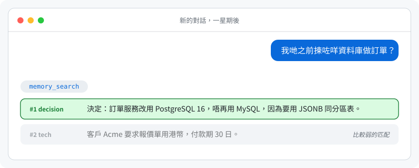
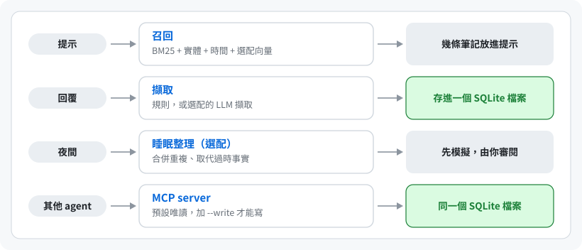

<div align="center">

# Hermind

**給 AI agent 用的長期記憶，全部存在你電腦上的一個 SQLite 檔。**

決定、偏好和事實會跨 session 保留；就算你換了說法問，用英文、中文或廣東話，都找得回來。不需要伺服器、不需要雲端帳戶、
不需要 LLM 或 API key。最先為 [Hermes](https://github.com/NousResearch/hermes-agent) 而做；任何支援 MCP 的 agent
都可以共用同一批筆記。

[English](README.md) · 繁體中文

 
 

</div>

---

## 它做甚麼

第一天，agent 記下一個決定（它自己記，或者你叫它記）。一星期後，在新的 session：

<p align="center"></p>

這是一個只有三則筆記、只用字詞搜尋的全新資料庫的真實輸出。問題和筆記完全沒有共同字詞時仍然可能找不到；選用的
[語意搜尋](docs/setup.md#semantic-search)用本機模型補回大部分（下載一次，不需要 API key）。

## 安裝

**最簡單：叫你的 agent 裝。** 跟它說：*「讀 https://github.com/fungane/hermind 裏的 AGENTS.md，幫我設定好 Hermind。」*
它會先問你裝在哪裏，給你看預演結果，先備份，最後給你還原指令（[AGENTS.md](AGENTS.md)，英文）。

**Hermes agent**（每輪對話前自動回想、每次回覆後自動記錄、審核佇列）：

```bash
git clone --branch v1.0.1 https://github.com/fungane/hermind.git ~/hermind
cd ~/hermind
python3 hermind_cli.py install-hermes --dry-run     # 顯示會做甚麼；其他 profile 加 --profile NAME
python3 hermind_cli.py install-hermes               # 先備份，再複製外掛，然後檢查結果
hermes config set memory.provider hermind           # 之後重新啟動 Hermes gateway／桌面 app
```

**Claude Code、Cursor、Codex 和其他 MCP 客戶端**（需要 [uv](https://docs.astral.sh/uv/)）：

```bash
claude mcp add hermind -- uvx --from git+https://github.com/fungane/hermind@v1.0.1 hermind-mcp --write
```

其他 20 多個客戶端的設定可以用 `hermind config CLIENT --write` 印出來（[docs/setup.md](docs/setup.md#mcp-clients)，英文）。
不加 `--write` 的話伺服器是唯讀的：agent 只能回想，不能記錄。單靠 MCP，agent 只會在它自己決定時才查筆記；在 Claude Code
可以用 `hermind install-hook` 加上每次提問前自動回想（[詳情](docs/setup.md#automatic-recall-in-claude-code)）。實際跑過
測試的只有 Claude Code 和官方 MCP TypeScript SDK；其他客戶端的設定是按各自的文件寫的。

**檢查一下，再在沒有 agent 的情況下試用：**

```bash
uvx --from git+https://github.com/fungane/hermind@v1.0.1 hermind selftest     # 幾秒完成，不碰任何真實資料
uvx --from git+https://github.com/fungane/hermind@v1.0.1 hermind remember "Atlas 的訂單用 PostgreSQL" --keywords "orders database 訂單 資料庫"
uvx --from git+https://github.com/fungane/hermind@v1.0.1 hermind search "訂單用哪個資料庫"
```

`@v1.0.1` 固定安裝測試過的版本；要升級就改這個數字。下面的 `hermind` 代表整句
`uvx --from git+https://github.com/fungane/hermind@v1.0.1 hermind`（或者用
`uv tool install git+https://github.com/fungane/hermind@v1.0.1` 裝一次指令）。

## 你的資料

| 途徑 | 資料庫 |
|---|---|
| MCP 伺服器及 `hermind remember/search` | `~/.hermind/memory.db`（或 `$HERMIND_DB`） |
| Hermes 外掛 | 每個 Hermes profile 裏的 `hermind.db`，例如 `~/.hermes/hermind.db` |

兩個途徑用不同的檔案，除非你指定同一個（`hermind config CLIENT --db-from-profile NAME`）。每個都是只有你能讀的單一
SQLite 檔。

- **匯出**全部：`hermind export --out notes.json`（也可以用 `--format jsonl`，或 `--format markdown --out DIR`）。
- **匯入** Markdown 資料夾、Claude Code、ChatGPT 或 Claude 的匯出檔、指示檔案或另一個 Hermind：`hermind import SOURCE`
  先預覽，`--apply` 先備份再匯入，`--revert` 可以撤回。
- **刪除**一則筆記用 `memory_forget` 工具（Hermes 外掛有；MCP 伺服器要加
  `--write --tools search,get,remember,update,forget` 才有）。**完全移除**：[docs/import-export.md](docs/import-export.md#uninstall)
  列出 Hermind 可能建立的每個檔案。
- **升級**前會先複製資料庫（`memory.db.bak-v<N>-...`，保留最新三份）；複製失敗就不會升級。

詳情：[docs/import-export.md](docs/import-export.md)（英文）。

## 為甚麼用 Hermind

| | |
|---|---|
| **一個檔，不用常駐程式** | 沒有資料庫伺服器、沒有背景服務、沒有帳戶。5,000 則筆記時一次搜尋約 20 毫秒 |
| **英文、中文、廣東話** | 三種語言都有同義詞組，繁簡互通；另有選用的本機語意搜尋（四種模型大小，52 至 568 MB），處理和筆記沒有共同字詞的問題 |
| **記得甚麼時候是真的** | 新事實會取代舊事實，但不刪除舊的；`as_of` 答得到「九月時我們用甚麼？」。每次合併都可以還原 |
| **預設保護私隱** | 完全離線可用。拒收密碼、金鑰一類內容，`<private>` 裏的文字永不儲存，選用的 LLM 呼叫前會遮蔽個人資料，有風險的 agent 寫入會等你審核，檔案可以加密 |

**適合：**你在自己的機器上跑 agent，想把它們的記憶放在一個自己讀得到、備份得到、搬得走的檔案，又不想多跑一個服務。
**不適合：**你需要託管服務、一個資料庫內分多個用戶權限、文件匯入或網頁介面。

## 有多輕？

在 Linux 上用 5,000 則虛構的短筆記實測；實際數字會隨筆記長度而變。

| | |
|---|---|
| 安裝套件（wheel，沒有依賴） | 約 230 KB |
| MCP 伺服器做完 20 次搜尋後 | 閒置約 29 MB 記憶體，尖峰 43 MB |
| 資料庫 | 每 5,000 則短筆記約 5 MB |
| 選用的語意搜尋（獨立的 worker，閒置 5 分鐘後自動結束） | 運行時 160 至 910 MB 記憶體，視乎模型 |

## 運作原理

<p align="center"></p>

在 Hermes，agent 會得到十個工具：`memory_remember`、`memory_search`、`memory_get`、`memory_related`（包括 `timeline`
和 `as_of`）、`memory_update`、`memory_feedback`、`memory_forget`、`memory_list`、`memory_review` 和 `memory_reflect`。
MCP 伺服器預設只列出四個唯讀工具，加 `--write` 有六個，其餘要指名才有。
[docs/how-it-works.md](docs/how-it-works.md)（英文）講解資料模型、搜尋與排序，以及召回表現。簡單講：在公開的
LongMemEval-S（470 條英文問題）上，單靠字詞搜尋，正確的 session 有 96.4% 排在頭 5 位；以一個人的真實筆記問 54 條
廣東話及英文日常問題，正確筆記排在頭 5 位的，字詞搜尋有 42 條，加上語意搜尋有 49 條。這只是一個用戶的資料，只供參考，不是保證。

## 私隱

筆記留在你機器上的檔案裏；沒有人會收到，包括作者。除非你自己開啟，否則不會有東西離開你的機器：你為選用工具設定的
LLM 端點（預設關閉）、語意搜尋的一次性模型下載，以及你的 MCP 客戶端送去它自己模型供應商的內容。靠規則找個人資料會漏掉
不常見的格式，儲存的文字也仍然可能帶有提示注入；兩者都只是減少，不是消除。完整清單和加密指南見
[docs/privacy.md](docs/privacy.md)（英文）。保安漏洞請按 [SECURITY.md](.github/SECURITY.md) 私下報告。

## 文件（英文）

| | |
|---|---|
| [docs/setup.md](docs/setup.md) | 安裝途徑、每個 MCP 客戶端、Hermes 外掛設定、語意搜尋、選用的 LLM 工具 |
| [docs/import-export.md](docs/import-export.md) | 匯入、匯出、備份 |
| [docs/privacy.md](docs/privacy.md) | 儲存甚麼、甚麼可能離開機器、加密 |
| [docs/how-it-works.md](docs/how-it-works.md) | 資料模型、搜尋與排序、每個工具、召回測量 |
| [docs/limitations.md](docs/limitations.md) | 還未做得好的地方 |
| [AGENTS.md](AGENTS.md) · [CHANGELOG.md](CHANGELOG.md) | 給 AI agent 的安裝手冊 · 每個版本的改動 |

## 狀態與支援

**早期版本，只有一個人每天在用，所以預計會有 bug。** 每次發佈前都會在 Linux 和 macOS 跑測試；暫時不支援 Windows。
請用 issue 表格回報問題（表格會問需要的資料，並提醒你不要貼真實筆記）。Issue 會先由 AI 助手看，它可能會起草修正；
每個回覆都由維護者審閱後親自發出，所以可能要等幾天。請開 issue，不要開 pull request：不接受外來的 pull request
（[CONTRIBUTING.md](.github/CONTRIBUTING.md)，英文）。

Hermind 由維護者設計，主要由 Claude（Anthropic）透過 Claude Code 和 Hermes agent 編寫，再由維護者審閱和測試。測試資料
全部是虛構的。這是獨立項目，並非由 Nous Research、Anthropic 或任何與它一起使用的產品製作、認可或附屬。

## 授權

MIT，見 [LICENSE](LICENSE)。
